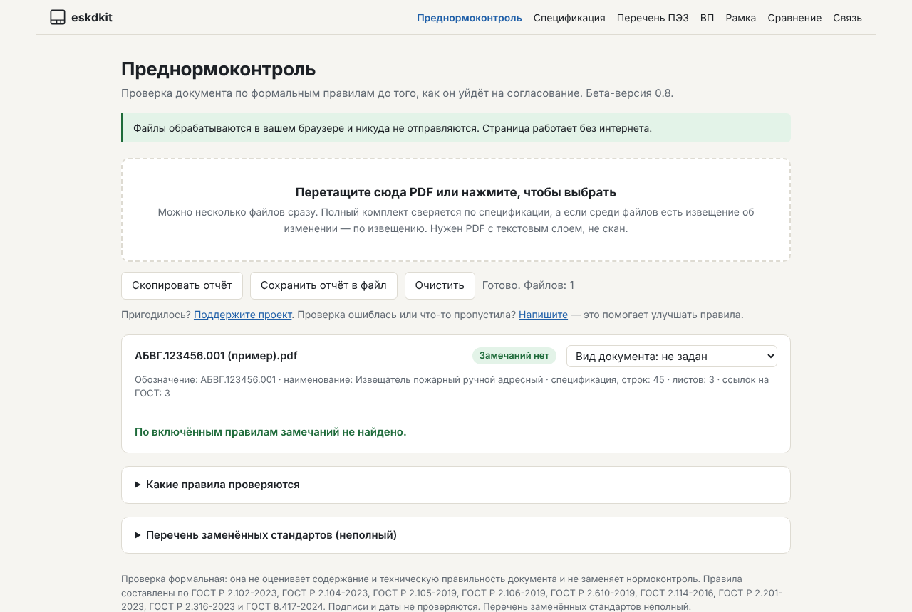
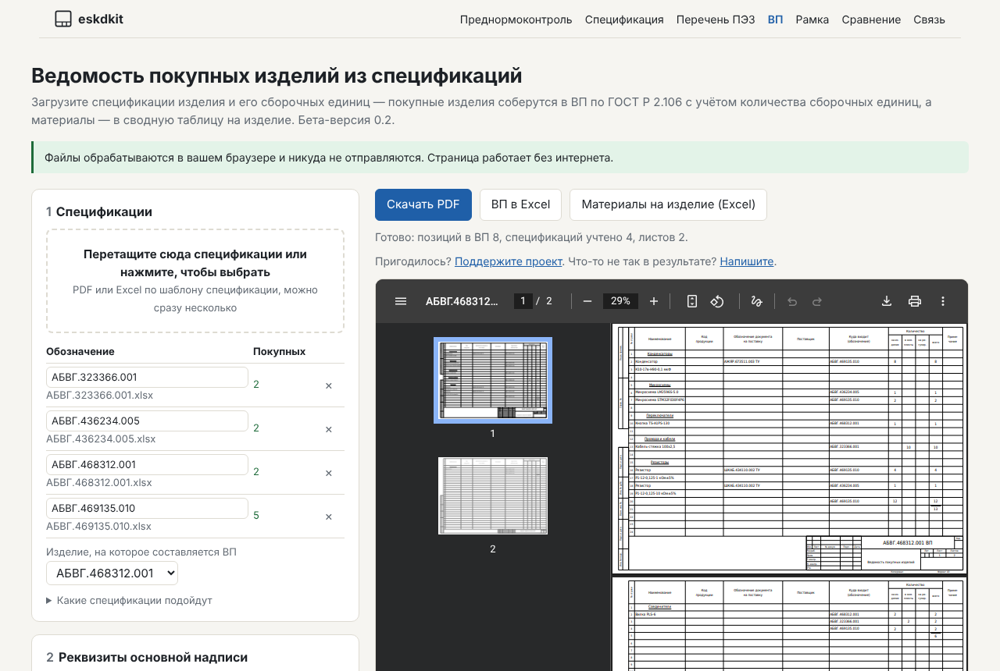
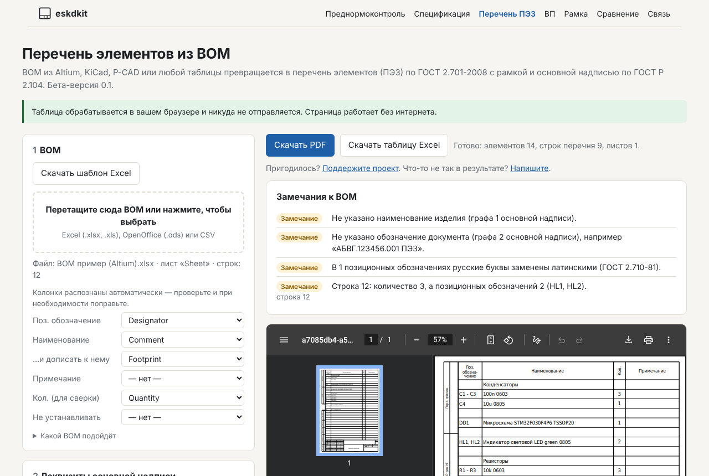
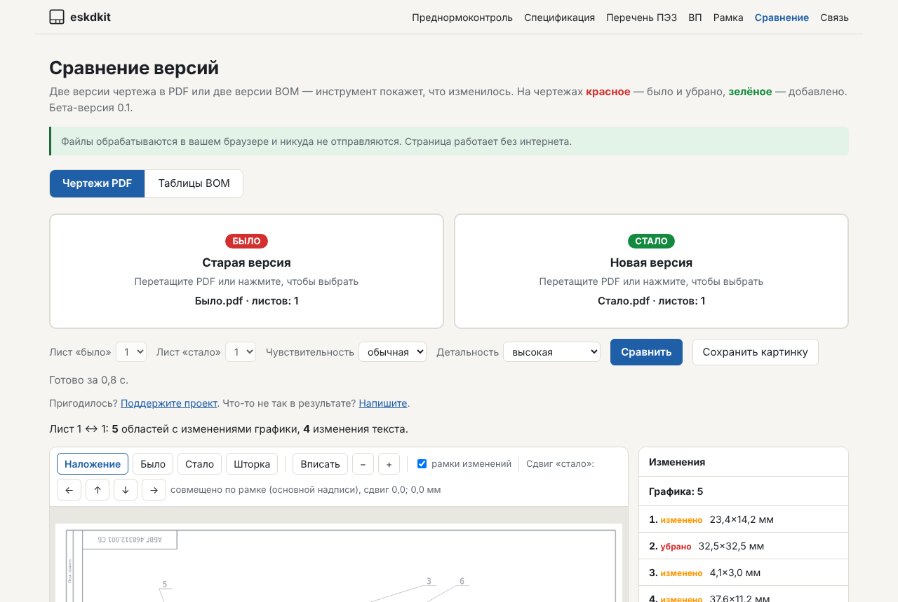
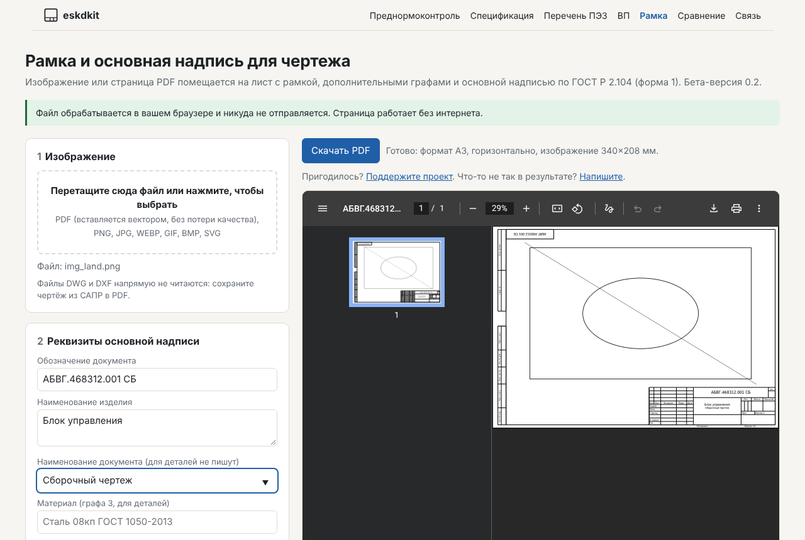

# eskdkit — бесплатные инструменты для конструкторской документации по ЕСКД

Исходный код сайта **[eskdkit.ru](https://eskdkit.ru)**: набор браузерных инструментов для оформления и проверки КД по ГОСТ ЕСКД.

Всё работает прямо в браузере. Файлы никуда не отправляются, сервера обработки нет, после загрузки страница работает и без интернета. Здесь можно убедиться в этом самостоятельно: весь код открыт.



## Инструменты

Новости и обновления — в Telegram-канале [@eskdkit](https://t.me/eskdkit).

| Инструмент | Что делает |
|---|---|
| [Преднормоконтроль](https://eskdkit.ru/prednormokontrol.html) | Проверяет PDF и Word (.docx) по формальным правилам ЕСКД до отправки на нормоконтроль: основная надпись, единицы величин, ссылки на заменённые стандарты, оформление текста. К простым замечаниям даёт готовое исправление. |
| [Спецификация](https://eskdkit.ru/specifikaciya.html) | Спецификация по ГОСТ Р 2.106-2019 из таблицы Excel: разделы, позиции, рамка и основная надпись, PDF. |
| [Перечень элементов ПЭ3](https://eskdkit.ru/perechen.html) | Перечень элементов по ГОСТ 2.701-2008 из BOM (Altium, KiCad, Excel): группировка, диапазоны позиционных обозначений, проверка BOM. |
| [Ведомость покупных изделий](https://eskdkit.ru/vedomost.html) | ВП из нескольких спецификаций (PDF или Excel) с учётом количества сборочных единиц и комплектов. Групповые спецификации, сквозная ВП с разбором деталей на материалы по нормам. |
| [Рамка и основная надпись](https://eskdkit.ru/ramka.html) | Рамка и основная надпись по ГОСТ Р 2.104 на изображение или PDF. Подписание ЭП или удостоверяющий лист с хэш-кодом по ГОСТ Р 34.11-2012. |
| [Пустые рамки ЕСКД](https://eskdkit.ru/blanki.html) | Бланки А4–А0 с рамкой и основной надписью по ГОСТ Р 2.104 (формы 1, 2, 2а) в PDF и шаблоном Word с автоматической нумерацией листов. |
| [Проверка актуальности ГОСТ](https://eskdkit.ru/proverka-gost.html) | Все ссылки на ГОСТ, ГОСТ Р и ПНСТ в тексте, PDF или Word сверяются с перечнями действующих стандартов Росстандарта: действует, заменён и на что. |
| [Обозначения по ГОСТ Р 2.201](https://eskdkit.ru/oboznachenie.html) | Проверка, расшифровка и сборка обозначений изделий и документов, справочник кодов документов. |
| [Ведомость ссылочных документов](https://eskdkit.ru/vedomost-ssylochnyh.html) | ВД по ГОСТ Р 2.106 из PDF и Word комплекта: ссылки на ГОСТ, ОСТ, СТО и ТУ, наименования из перечней Росстандарта, разделы, PDF и Excel. |
| [Сравнение версий](https://eskdkit.ru/sravnenie.html) | Сравнение двух версий чертежа в PDF наложением и сравнение таблиц BOM. Текст извещения об изменении по ГОСТ Р 2.503-2023 и бланк извещения. |

<table>
<tr>
<td></td>
<td></td>
</tr>
<tr>
<td></td>
<td></td>
</tr>
</table>

## Как устроено

Каждый инструмент — одна HTML-страница, в которую при сборке встраиваются все скрипты, библиотеки и шрифт. Получается самодостаточный файл: его можно открыть локально двойным щелчком или выложить на любой статический хостинг.

| Файлы | Назначение |
|---|---|
| `core.js`, `ui.html` | Преднормоконтроль: разбор PDF, правила проверки, интерфейс |
| `speccore.js`, `specui.html` | Спецификация |
| `pecore.js`, `peui.html` | Перечень элементов |
| `vpcore.js`, `grpspec.js`, `vpui.html` | Ведомость покупных изделий, разбор групповых спецификаций |
| `framecore.js`, `ulcore.js`, `gost3411.js`, `frameui.html` | Рамка, удостоверяющий лист, хэш ГОСТ Р 34.11-2012 «Стрибог» |
| `blankcore.js`, `blankui.html` | Пустые бланки: PDF и DOCX из одной геометрии |
| `docxread.js` | Чтение Word (.docx) без библиотек: ZIP, XML, нумерация списков, таблицы, колонтитулы |
| `stdcore.js`, `stdui.html`, `stddata.js`, `data/` | Проверка ГОСТ: поиск обозначений, сверка с перечнями Росстандарта (открытые данные, `data/*.csv`) |
| `desigcore.js`, `desigui.html` | Обозначения по ГОСТ Р 2.201 |
| `vdcore.js`, `vdui.html` | Ведомость ссылочных документов |
| `cmpcore.js`, `bomcmp.js`, `iicore.js`, `cmpui.html` | Сравнение версий чертежей и BOM, извещение об изменении |
| `eskdpdf.js` | Общая отрисовка форм ЕСКД в PDF: рамка, основные надписи, боковые графы |
| `site/build.js`, `site/build0.js` | Сборка сайта: страницы, навигация, справка, sitemap |
| `examples/` | Вымышленные примеры для проверки инструментов |

## Сборка

Нужен Node.js 18 или новее.

```
npm install
node site/build.js
```

Готовый сайт появится в папке `dist`. Настройки (домен, почта, ссылки на форму обратной связи и донаты) — в начале `site/build.js`.

## Ограничения

Проверки формальные: инструменты не оценивают техническое содержание документов и не заменяют нормоконтроль. Распознавание PDF рассчитано на документы с текстовым слоем; если текст в PDF нарисован линиями, его прочитать нельзя.

## Обратная связь

Ошибки и пожелания — через [форму на сайте](https://eskdkit.ru/svyaz.html), на почту eskdkit@yandex.ru или в Issues этого репозитория.

Если инструменты пригодились, проект можно [поддержать](https://pay.cloudtips.ru/p/834f326c).

## Лицензия

Код проекта — [MIT](LICENSE). Используемые библиотеки распространяются под своими лицензиями, их тексты в папке [`licenses`](licenses):

- [PDF.js](https://github.com/mozilla/pdf.js) — Apache-2.0
- [pdf-lib](https://github.com/Hopding/pdf-lib) — MIT
- [@pdf-lib/fontkit](https://github.com/Hopding/fontkit) — MIT
- [SheetJS Community Edition](https://sheetjs.com) — Apache-2.0
- шрифт [DejaVu](https://dejavu-fonts.github.io) (подмножество гарнитуры DejaVu Sans Condensed) — свободная лицензия Bitstream Vera / DejaVu

Тексты ГОСТов в репозиторий не входят.
